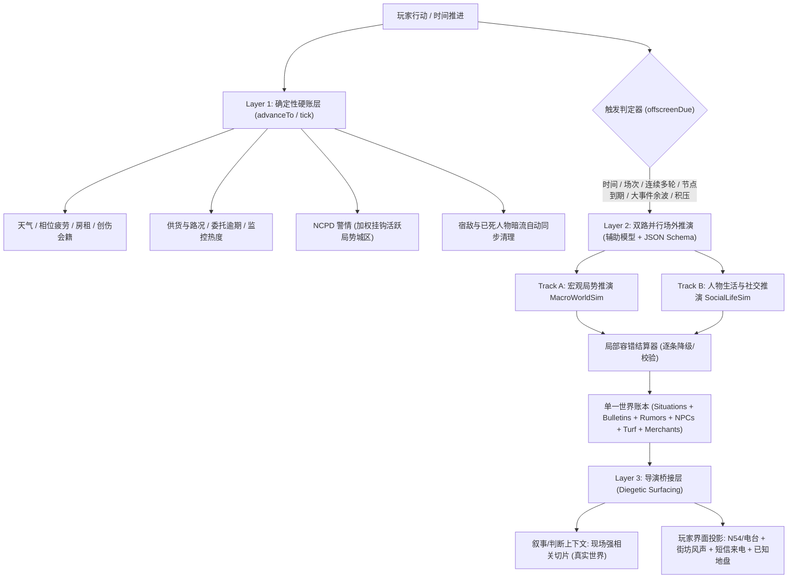

# 夜之城世界演化机制重构策划案

> 状态：Phase 1 + Phase 2 已落地（静态类型与规范检查通过，待用户试玩验收）；Phase 3 待体感评估后决定
> 创建日期：2026-11-21
> 更新日期：2026-11-21
> 落地提交：`df8b3c4`（Layer 1 确定性硬账层与断链修复）、`587216c`（统一局势账本与导演桥接层）、`cbd65c3`（双路并行场外推演、四维触发器与分级容错）
> 适用前提：制作阶段不做历史兼容；提示词优化以正文质量为主，文笔交给预设；**不改动现有前端界面、布局、样式与展开面板**；测试与验收由用户自行执行（开发阶段仅做静态类型与规范检查）。

---

## 1. 现状诊断与重构目标

### 1.1 现行机制的核心问题

当前世界演化采用「确定性 `tick` + 回合第 ⑥ 步场外推演 `offscreen`」双轨骨架，方向正确，但在实现层存在四类结构性硬伤与多项具体断链：

1. **单次超载 + 零容错，导致连环失败或内容平庸**
   - [offscreen.ts](file:///c:/cyberpunk-character-card/packages/core/src/narrator/offscreen.ts) 让辅助模型在一次无 Zod JSON Schema、无 `repair` 兜底的输出中，同时维护 10 类互相关联的账本（`events`、`merchantChanges`、`npcs`、`pasts`、`ties`、`rumors`、`bulletin`、`deaths`、`messages`/`calls`/`jobs`、`threads`）。
   - `readOffscreen` 与 [turn.ts](file:///c:/cyberpunk-character-card/packages/core/src/narrator/turn.ts#L1830-L1866) 采用**全批原子回滚**：哪怕一条 NPC 移动地点拼错、一条传闻多关联了事件 id、或列表超出软上限，均会触发 `reject()` 导致整批作废并进入 `city.failed` 退避（15 → 30 → 60 → 120 分钟），待处理正文越攒越多。
2. **后台账本割裂与重复记账**
   - 城中事件同时分散在 `city.events`、`threads`、`data.canon` 静态时间线和随机 `ncpd` 警情四处。
   - 同一场帮派火并需要模型手写进 `threads`、`events`、`rumors`、`bulletin` 四处并手动对齐 ID；而 [world/feed.ts](file:///c:/cyberpunk-character-card/packages/core/src/systems/world/feed.ts#L48-L72) 又绕过本局演化直接把 [lore.ts](file:///c:/cyberpunk-character-card/packages/content/src/lore.ts) 里的静态 `canon` 原文按天数硬推到 N54 新闻频道，与「玩家可改写世界线」的原则直接打架。
3. **「幕后演化 → 玩家体感」转化漏斗过窄**
   - 绝大多数推演结果只留在后台，要求主叙事模型从几十条全城背景中自行挑拣，并依赖抽取阶段精准补标 `rumorHeard` / `threadTold` / `learn`。玩家经常连续十几轮感受不到世界在变。
4. **若干具体代码断链**
   - `bulletin.threads` 校验未区分 `thread.step` 与 `open/defer/close`，容易在 `applyTold` 阶段触发整批回滚。
   - `tickThreads` 只清理已死宿敌，不清理已死 NPC 的心事（`concern`），`applyArcOffscreen` 也不检查存活，导致死人个人线继续占槽并推进。
   - 给叙事模型的 `turfSection`（[factions/threats.ts](file:///c:/cyberpunk-character-card/packages/core/src/systems/factions/threats.ts#L53)）误传 `toldOnly = true`，场外隐蔽易主的地盘无法在现场触发反应。
   - 首次推演前 12 小时保底计时使用 `was.sceneStartedAt` 而非 `was.startedAt`，每次收场重置计时；`offscreenSkipReason` 未区分退避期。

### 1.2 重构目标

| 维度 | 目标状态 |
| :--- | :--- |
| **世界真实感** | 单一事实源：任何新闻、流言、地盘、商家、人物命运都出自本局真实因果，不再出现静态原作强行打脸本局剧情。 |
| **知情边界** | 严格区分「世界真实状态（叙事模型可见）」与「玩家听闻状态（界面可见）」，肉眼可见的现场事实到访即显，幕后隐情必须经由渠道传出。 |
| **执行稳定性** | 原生 JSON Schema 强约束 + 双路轻量拆解 + 局部容错降级，彻底消除「一处小错整批作废」和雪崩式退避。 |
| **正文质感与体感** | 后台推演拆出「宏观局势」与「人物生活」两条专注通道，产出更有活人感；叙事端按现场相关性精准投喂，让玩家在日常对话、走街串巷、看新闻收短信中自然感受到夜之城在呼吸。 |
| **界面零改动** | 完全复用现有投影接口（`view.bulletins`、`view.feed`、`view.factions`、`view.npcs`、`view.jobs`、`view.phone`），不改 UI 布局与样式。 |

---

## 2. 总体架构：三层世界演化引擎



---

## 3. Layer 1：确定性硬账层（Deterministic World Tick）

负责一切不依赖自由创作、必须严格守恒的物理与制度演化。

### 3.1 保留并加固的现有 `tick`
- `world`：6 小时无状态天气、四段相位与疲劳状态、期限预警。
- `inventory` / `cyberware` / `logistics`：按时间与道路封锁推进商店补货、义体供货与工坊耗时。
- `jobs`：委托过期与逾期标记。
- `safehouse` / `trauma` / `health` / `heat` / `combat` / `phone`：房租宽限与电子锁门、创伤会籍、伤势恢复、监控录像入库与热度衰减、来电超时。

### 3.2 新增与修复的硬规则
1. **废除静态 `canon` 直推新闻频道**
   - 删除 [world/feed.ts](file:///c:/cyberpunk-character-card/packages/core/src/systems/world/feed.ts#L47-L72) 中按天数直接往 `news` 频道塞入 `data.canon` 的代码。
   - `data.canon` 退回其真正定位：**只供 `MacroWorldSim` 与叙事阶段参考的「无人插手时的夜之城大势底稿」**，任何播给玩家的 N54 快讯都必须来自本局真实落账的 `bulletins`。
2. **已死 NPC 的暗流自动收场**
   - [threads/apply.ts](file:///c:/cyberpunk-character-card/packages/core/src/systems/threads/apply.ts#L263-L295) 的 `tickThreads` 同时检查 `kind === "nemesis"` 与 `kind === "concern"`：只要 `owner` 已死（`npcs[owner]?.alive === false`），自动将其归档收场（`end: "当事人在变故中身亡，此事无疾而终"`），释放槽位。
   - 若为 `concern`，同时向 `arcs` 发出内部终止标记（不再允许死后继续推进）；`applyArcOffscreen` 增加 `if (!card?.alive) return fail(...)` 硬校验。
   - 当 `npcDeath` 或 `npc.offscreenDeath` 发生时，也可通过 `npc.died` 信号即时触发清理，不再苦等下一次时间推进。
3. **NCPD 警情与活跃城中动荡联动**
   - [ncpd/apply.ts](file:///c:/cyberpunk-character-card/packages/core/src/systems/ncpd/apply.ts) 读取当前处于 `heating` 状态的活跃局势所在城区，生成新警情时对动荡城区给予权重加成（如 2×），让街头治安与帮派/公司动作产生可感知的因果呼应。
4. **地盘视野分离修正**
   - [factions/threats.ts](file:///c:/cyberpunk-character-card/packages/core/src/systems/factions/threats.ts#L53) 中给叙事模型的 `turfSection` 改为 `currentTurf(state, data, false)`（读取**真实地盘**）；
   - 玩家面板 `factionsView` 与玩家威胁栏 `factionsThreats` 继续使用 `toldOnly = true`（读取**玩家已听闻地盘**）。
   - 当玩家亲自进入发生隐蔽易主的城区并在正文中目击后，抽取发出 `threadTold` 即可同步公开该区地盘。

---

## 4. Layer 2：统一世界账本与双路解耦推演

### 4.1 账本收敛：把 `city.events` 与 `threads` 合并为统一「城中局势」

旧架构最大浪费在于 `city.events`（自由动静）和 `threads`（势力/宿敌/心事定时单子）并存，导致同一件事被模型手写两遍再人工关联传闻与快讯。

**新模型：统一为 `Situation`（落账在 `city` 或收敛后的 `worldSim` 切片，保留清晰分类）**

| 字段 | 类型 | 说明 |
| :--- | :--- | :--- |
| `id` | `slug` | 唯一标识（小写英文/数字/连字符） |
| `kind` | `"civic" \| "faction" \| "nemesis" \| "concern"` | `civic` 替代原自由 `city.event`（突发冲突、玩家余波、大事件演化）；其余三类保留原 `threads` 语义 |
| `owner` | `string \| null` | 势力 id / NPC id（`civic` 可为 `null`） |
| `seed` | `string \| null` | 关联的势力素材或心事种子 id（或采纳的 2077 `canon` 节点 id） |
| `title` | `string (≤24字)` | 局势标题 |
| `district` | `string \| null` | 主要波及城区（用于现场相关性过滤与 NCPD 联动） |
| `weight` | `"minor" \| "normal" \| "major"` | 传播量级（`major` 为头条级大事） |
| `status` | `"brewing" \| "heating" \| "cooling" \| "over"` | 生命周期状态 |
| `want` | `string (≤120字)` | 驱动意图/核心矛盾 |
| `stage` | `string (≤80字)` | 当前阶段一句话 |
| `dueAt` | `number` | 下次自然发酵时间（游戏分钟）；`civic` 同样带自然发酵节奏，不再悬空僵尸化 |
| `reminded` | `boolean` | 到点未处理提醒标记（超 1 次自动延后 3 天或自然降温） |
| `steps` | `SituationStep[]` | 最近 6 步：每步含 `at`、`kind (move\|push\|stall\|derail)`、`truth`（幕后真相）、`publicText`（公开说法）、`turf`、`told` |
| `openedAt` / `updatedAt` / `closedAt` | `number` | 时间戳 |

**硬上限与自动代谢**：
- 活跃局势总上限 `10` 件（其中 `faction`/`nemesis`/`concern` 合计 ≤ 8 件，`civic` 灵活占位），已结束归档保留最近 `12` 条供检索与因果延续。
- 长时间无推进且 `status === "cooling"` 超过 7 个游戏日的 `civic` 局势可在 `tick` 中自动自然平息归档，避免账本堆满僵尸事件。

---

### 4.2 双路解耦推演（并行执行，各自带原生 JSON Schema）

将原来庞大脆弱的一次调用，拆为 **Track A（宏观局势）** 与 **Track B（人物生活与社交）** 两个独立轻量推演器。两者**共享同一批增量正文快照（`processedThrough` 至本轮）**，在 [turn.ts](file:///c:/cyberpunk-character-card/packages/core/src/narrator/turn.ts) 中通过 `Promise.all` **并行调用**（总耗时 ≤ 原单次大 Prompt，且每次调用输出短、逻辑纯、失败互不传染）。

#### Track A：`MacroWorldSim`（宏观局势、媒体与商家经营）

- **唯一职责**：沿着本批新事实、活跃局势、留置隐患与 2077 大势参考，推进夜之城的宏观变化。
- **输入裁剪**：
  - 当前状态简报（时间、日期、地点、天气、活跃委托、未回应期限、遗弃车辆与留置物件）
  - 本批增量正文（`processedThrough + 1` 至本轮）
  - 活跃局势清单（`situations`，标明哪些已到点）+ 近期收场摘要
  - 相关势力素材与已激活心事种子（仅已存在前因或本批相关者）
  - 当前游戏日窗口内的 2077 `canon` 脉络（明确标示：仅作无冲突背景参考，可采纳开局势、可按本局事实彻底改写，也可忽略）
  - 已激活商家与供货路线（仅当存档内存在已激活商家时注入）
  - 跨度提示：若距上次推演已过 `≥ 48` 小时，明确告知本次跨度为 `N` 天，可合理推进更大幅度演变。
- **原生 JSON Schema 输出**（经 `responseJsonSchema("offscreen_macro", MacroOffscreenSchema)` 强约束）：
  ```json
  {
    "situations": [
      {
        "op": "open | step | defer | close",
        "id": "slug",
        "kind": "civic | faction | nemesis | concern",
        "owner": "optional id",
        "seed": "optional seed id",
        "title": "optional <=24字",
        "district": "optional 城区",
        "weight": "minor | normal | major",
        "status": "brewing | heating | cooling | over",
        "want": "optional <=120字",
        "stage": "optional <=80字",
        "truth": "本步实际发生的幕后真相（<=160字）",
        "publicText": "传开后的公开版本（<=80字）",
        "days": 3,
        "turf": { "faction": "id", "district": "城区", "change": "gain | lose" },
        "playerCred": "small | medium | large",
        "fate": "better | canon | worse",
        "rumors": [
          { "text": "街上传的原话（<=80字）", "truth": "true|exaggerated|garbled", "reach": "street|district|city", "district": "可选", "player": false }
        ]
      }
    ],
    "standaloneRumors": [
      { "text": "与局势无关的零星街头传闻（<=80字）", "truth": "true|exaggerated|garbled", "reach": "street|district|city", "district": "可选", "player": false }
    ],
    "bulletin": {
      "kind": "news | radio",
      "channel": "N54 | WNS | 地下电台名",
      "title": "<=24字",
      "text": "<=200字播报原文",
      "situationIds": ["本次播报公开提及的局势 id"]
    },
    "merchantChanges": [
      {
        "type": "shopBusiness | cyberware.clinic | logistics.route",
        "target": "shop/doc/location id",
        "sourceSituation": "本批或已有局势 id",
        "reason": "事实原因",
        "evidence": "从该局势 truth/publicText 中引用的事实片段"
      }
    ]
  }
  ```
- **关键简化点**：
  - `rumors` 直接内嵌在对应 `situation` 下，彻底消灭「传闻引用了不存在的 event id」类错误；
  - `bulletin.situationIds` 在校验层只认可本批执行了 `step`、或原本就有未公开 `steps` 的局势；若引用了仅 `open`/`defer` 的局势，**自动过滤掉该 id 并记入 `considered`，不再报错回滚**；
  - `merchantChanges` 的 `evidence` 匹配改为语义规范化子串比对（去标点空白），且仅作用于该单条，不合法仅丢弃该条经营变更。

#### Track B：`SocialLifeSim`（人物过日子、人际网、命运与主动联系）

- **唯一职责**：让夜之城里的有卡人物像活人一样过自己的日子，并在合情合理时主动联系玩家或派活。
- **输入裁剪**：
  - 当前状态简报（时间、玩家位置、近期动荡标题列表——只给 1 行摘要供人物闲聊/反应，不给繁杂硬账）
  - 本批增量正文（用于感知玩家刚和谁结怨/立功/约定）
  - 人物索引（全量身份、势力、位置、生死、在场/同行标记）
  - 详卡清单：`lifePicks`（2 名最久未更新近况的在世非在场 NPC）+ 本批正文/活跃委托牵涉人物 + 一跳关系人 + 最近见过的 4 人
  - 待压缩经历清单（`timeline.length >= TIMELINE_SQUASH`）
  - 可联系玩家名单（见过、活着、非在场、非同行）+ 能派单的中间人名单（当未接委托 `< OFFERED_CAP` 时）
  - 近期活跃/收场委托背景
- **原生 JSON Schema 输出**（经 `responseJsonSchema("offscreen_social", SocialOffscreenSchema)` 强约束）：
  ```json
  {
    "npcs": [
      { "id": "npc-id", "doing": "最近在做什么（<=80字）", "location": "optional 已有地点 id" }
    ],
    "pasts": [
      { "id": "npc-id", "text": "较早经历压缩摘要" }
    ],
    "ties": [
      { "a": "id1", "b": "id2", "aToB": "一句", "bToA": "一句", "open": true }
    ],
    "deaths": [
      { "id": "canon-npc-id", "cause": "<=80字", "rumor": "可选：让外界听说的风声一句话" }
    ],
    "jobs": [
      { "id": "slug", "title": "<=24字", "kind": "可选", "fixer": "中间人id，熟人托事省略", "client": "雇主", "location": "可选", "risk": 1, "reward": 1500, "due": "YYYY-MM-DD HH:mm", "conflict": "核心冲突", "twist": "可选幕后真相" }
    ],
    "messages": [
      { "from": "npc或中间人id", "text": "口语短信原文", "job": "可选委托id" }
    ],
    "calls": [
      { "from": "npc或中间人id", "about": "来意（只给叙事模型，<=200字）" }
    ]
  }
  ```
- **关键优化点**：
  - `deaths` 自带可选 `rumor` 字段，若原作人物死于场外，系统自动顺手生成一条未听说的街头风声，保证玩家后续有机会听说，不再遗漏；
  - `npcs` 若给了表外 `location`，代码仅剥离 `location`、保留 `doing`（真正落实「近况照收，位置不动」）；
  - **独立提交**：即使 Track A 或 Track B 有一路因上游波动失败，另一路仍然有效提交，互不拖累（分别记录 `macroProcessedThrough` 与 `socialProcessedThrough`，或统一在两路均未硬失败时推进主游标、单路失败仅重跑失败那一路）。

---

## 5. 触发策略与分级容错设计

### 5.1 四维触发条件（替换现有 `offscreenDue`）

只要满足以下任一条件（且非死亡、非闪回、非 `unsettled`、设置未关、未处于对应通道退避期），即触发推演：

1. **场景节拍**：收场且 `now.scene - (lastScene ?? 0) >= every`（`fast=2 / normal=3 / slow=5`）。
2. **连续长对话防冻结**：同一场景内未收场，但距离上次推演已累计经过 **≥ 8 轮有效行动** 且游戏时间推进 **≥ 2 小时**。
3. **时间跨度保底**：`since = lastAt ?? was.startedAt ?? was.sceneStartedAt`，只要 `after.time - since >= 12 * 60` 即触发（**不再要求本轮恰好 `after.time > before.time`**，避免手机私信或未定稿回合跨过 12 小时后卡死）。
4. **节点与大事件驱动**：
   - 有活跃 `situation`、`job`、`deadline` 到期（同一截止期只催一次）；
   - 玩家刚插手某局势（`push`）；
   - 本轮出现高烈度余波事件（`jobEnd`、大型战斗结束、新宿敌诞生、关键 NPC 死亡）且本轮收场或时间推进 ≥ 30 分钟；
   - 存在历史积压 `backlog === true` 或失败退避到期 `after.time >= retryAt`。

> **退避机制改良**：单路硬失败后，退避条件设为「**游戏时间过去 15/30/60/120 分钟，或者有效行动推进满 3 轮**（先到为准）」，防止玩家在原地纯对话不推进时钟时永远卡在退避里；同时在 `offscreenSkipReason` 中明确输出「上次推演失败，等待重试」，不再误报原因。

### 5.2 分级容错矩阵（彻底告别「一错全毁」）

| 错误级别 | 典型情形 | 处理方式 |
| :--- | :--- | :--- |
| **L0：结构级硬失败** | 网络错误、上游拒答、非 JSON、顶层缺必需结构 | 走 1 次限额内轻量 `repair`；仍失败则该通道记 `failed` 进入退避，保留待处理增量游标，不污染世界状态。 |
| **L1：单条可降级偏差** | NPC 移动地点不在表里；超软上限；`bulletin.situationIds` 引用了无新进展事项；消息附错委托 id；地盘变更不满足硬账 | **局部清洗/降级**（去地点保近况、截断多余项、剥离无效关联、去地盘保进展），写明原因进 `considered`，**整批照常提交**。 |
| **L2：单条无效指令** | 某条 `npcs` 误写了在场人或死人；某条 `merchantChanges` 证据不足；某条 `situation` 操作引用了不存在的 id | **跳过该单条**，写明原因进 `considered`，**其余合法条目正常结算提交**。 |

---

## 6. Layer 3：导演桥接层（打通「幕后 → 正文与体感」）

这是决定玩家**能不能真正感觉到夜之城活着**的最关键一环。严格遵循 `AGENTS.md` 约定：**只传递客观世界事实与知情边界，不注入通用文风、修辞或感官配额，文笔完全交给写作预设**。

### 6.1 叙事上下文：从「全城倾倒」改为「现场相关性切片」

给 `judge` 与 `narrate` 阶段的情境节改为两级结构，减少无关噪音，显著提高模型对当前世界变化的响应率：

1. **【眼前与本区实时风声】（高相关性，上限 3 条）**
   - 自动筛选以下高相关条目（按紧迫度排序取前 3）：
     - 当前所在城区处于 `heating` / `brewing` 状态的活跃局势及其未听说的街头传闻；
     - 涉及当前在场 NPC（或其一跳关系人/所属势力）的最新场外进展、近况或未传开的死亡；
     - 全城 `weight === "major"` 且 `told === false` 的最新头条级局势。
   - **标明知情状态**：明确标注「玩家尚未听说（可借本地路人、电台、电视屏幕或熟人口风自然带出；非强制，战斗与闪回中不带）」或「玩家已知」。
2. **【城中远方脉动】（低相关性，单行索引）**
   - 其余城区的活跃局势只留「`id｜标题｜城区｜状态`」极简索引，避免占满上下文；仅当玩家主动打听、查网或跨区前往时才在下一轮展开。

### 6.2 肉眼可见事实的「到访自动显影」

区分两类知识：
- **隐秘/远方信息**（幕后真相、别区传闻、原作人物场外死亡、势力暗算）：严守知情边界，必须经由正文透出并由抽取标记 `rumorHeard` / `threadTold` / `learn` 后才进玩家界面。
- **现场公开物理事实**（所到商店停业、诊所关门、所经道路封锁、已公开广播的 `bulletin`）：
  - `bulletin` 生成即进入玩家界面「N54 与电台」（不需正文手标）；若某条 `bulletin` 公开播报了某局势的新进展，该局势步骤同步标 `told = true` 并更新玩家可见地盘；
  - 商店停业/诊所关门/封路在玩家身处该地点时直接作为现状呈现给叙事与前端，不再出现「人站在关了门的店门口却还要等别人传谣才知道关门」的反常识现象。

### 6.3 前端投影无缝对接（零 UI 改动）

| 现有前端面板 / 字段 | 新架构数据源映射 | 变化说明 |
| :--- | :--- | :--- |
| `NewsPanel` — `view.bulletins` | `MacroWorldSim` 产出的 `bulletins`（N54 / WNS / 地下电台） | 保持原结构；消灭重复或与本局矛盾的静态播报 |
| `NewsPanel` — `view.feed (street)` | 玩家听说了的 `rumors` + `situations` 已听闻公开说法 | 统一去重，不再同一件事出现多条重复卡片 |
| `Phone` — `view.feed (messages)` | `SocialLifeSim` 产出的私信、来电、派单与熟人托事 | 保持原结构；因专职推演，人物口吻与前因更自然 |
| `FactionsPanel` — `view.factions` | `turf`（`toldOnly = true`）与公开地盘新闻 | 玩家面板不剧透，叙事层 `turfSection` 改看真实地盘 |
| `GigsPanel` — `view.jobs` | `SocialLifeSim` 派单 / 熟人托事 + `tickJobs` 逾期 | 保持原结构 |
| `SettingsScreen` — `ctx.offscreenSkip` | 新增退避期说明与双通道简报（如宏观/社交各自状态） | 复用原文本位，不改界面布局 |

---

## 7. 涉及模块与文件清单

制作阶段不做历史兼容，直接清理旧的双轨代码与冗余定义：

- **统一局势与城中状态**
  - 重构 `packages/core/src/systems/city/`（吸收 `threads` 统一为 `Situation` 账本，保留 `bulletins`、`rumors`、双通道游标与退避状态；或保留 `threads` 为统一局势系统并精简 `city` 仅管媒体与传闻，二选一保持单一事实源——**推荐保留 `city` 管媒体/传闻/演化游标，`threads` 升级为全类型局势账本（新增 `civic` 类型替代 `city.events`）**，模块边界最清晰且依赖图变动最小）。
  - 修改 `packages/core/src/systems/threads/`（新增 `civic` 类型、`weight`、`district`、`status`、`rumors` 关联；`tickThreads` 补齐已死 `concern` 清理）。
  - 修改 `packages/core/src/systems/arcs/apply.ts`（`applyArcOffscreen` 增加存活校验）。
  - 修改 `packages/core/src/systems/factions/threats.ts`（`turfSection` 改为 `toldOnly = false`）。
  - 修改 `packages/core/src/systems/world/feed.ts`（移除 `data.canon` 硬推新闻逻辑）。
  - 修改 `packages/core/src/systems/ncpd/apply.ts`（警情生成加权参考活跃动荡城区）。
- **双路场外推演器与编排**
  - 拆分 `packages/core/src/narrator/offscreen.ts` 为：
    - `offscreen-trigger.ts`（四维触发器、跨度计算、跳过原因、增量批次切片）
    - `offscreen-macro.ts`（Track A 提示词、Zod JSON Schema、局部容错解析）
    - `offscreen-social.ts`（Track B 提示词、Zod JSON Schema、局部容错解析）
    - `offscreen-merchants.ts`（放宽空白/标点归一化比对、接入局势源校验）
    - `offscreen.ts`（统一导出与协调入口）
  - 修改 `packages/core/src/narrator/turn.ts`（第 ⑥ 步改为并行调用 Track A + Track B、L0 限额修复 + L1/L2 逐条容错提交）。
  - 修改 `packages/core/src/narrator/prompts/context.ts` 与 `systems/city/sections.ts` / `systems/threads/prompt.ts`（接入 Layer 3「眼前与本区实时风声 + 远方脉动」相关性切片）。
- **服务端与剧透视图**
  - 微调 `apps/server/src/game.ts`（剧透视图记录双路推演 trace 与准确跳过原因，保持现有 API 形状）。

---

## 8. 分阶段实施计划

### Phase 1：止血修复与容错底座（已完成 — `df8b3c4`, `cbd65c3`）
1. 修复全部已知断链：
   - 移除 `worldFeed` 对 `data.canon` 的硬播；
   - `turfSection` 改为真实地盘（`toldOnly = false`）；
   - `tickThreads`、`on["npc.died"]` 与 `applyArcOffscreen` 补齐死人 `concern` 清理与存活拦截；
   - `trackOffscreenDue` 首次时间基准改用 `was.startedAt ?? was.sceneStartedAt`，去掉 `after.time > before.time` 卡点；
   - `offscreenSkipReason` 补充退避期说明。
2. 落地 L0/L1/L2 分级容错：区分结构硬错与单条降级/丢弃，修掉 `bulletin.situationIds` 校验漏判。
3. 为双路场外推演补齐原生 Zod JSON Schema（`MacroOffscreenDocSchema` / `SocialOffscreenDocSchema`）与每通道 1 次限额内 `repair`。

### Phase 2：账本收敛、双路解耦与导演桥接（已完成 — `587216c`, `cbd65c3`）
1. 将 `civic` 城中突发事件收敛进 `threads`（含 `weight`、`district`、`status`、`updatedAt`），并在开立/推进/收场时自动 `emit` 同步底层 `city.events`，供 `logistics`/`inventory`/`cyberware`/`ncpd` 与剧透视图无环共享，彻底消灭重复记账。
2. 拆分 `MacroWorldSim`（[offscreen-macro.ts](file:///c:/cyberpunk-character-card/packages/core/src/narrator/offscreen-macro.ts)）与 `SocialLifeSim`（[offscreen-social.ts](file:///c:/cyberpunk-character-card/packages/core/src/narrator/offscreen-social.ts)），通过 `Promise.all` 并行执行并按 `city.macro` / `city.social` 独立容错提交。
3. 落地四维触发器（[offscreen-trigger.ts](file:///c:/cyberpunk-character-card/packages/core/src/narrator/offscreen-trigger.ts)）：支持同场景长对话防冻结（≥8 轮且 ≥2 小时）、大事件余波即时推演、多日快进跨度提示、以及时间/回合双保险退避。
4. 落地 Layer 3 导演桥接层：叙事端改为「【眼前与本区实时风声】（上限 3 条）+【城中远方脉动】」相关性切片；NCPD 警情对 `heating` 动荡城区 2× 加权。
5. 清理旧单轨实现并重写对应单元测试与校验脚本引用；`@cp/core`、`@cp/content`、`@cp/server`、`@cp/web` 静态类型检查零报错，`biome check` 零报错。

### Phase 3：后台非阻塞化演进（可选，待定）
- 若 Phase 2 上线后实测并行双路延迟仍影响回合收尾体感，再将第 ⑥ 步拆出回合主响应流，改为「正文 commit 后后台执行 → 下一轮开跑前合并（带版本锁与冲突丢弃/重试）」。由于涉及并发日志合并复杂度，需待 Phase 2 真实游玩体验后再决定是否启用。

---

## 9. 检查与验收标准

按项目约定，开发完成每阶段后仅执行静态检查，不主动跑自动化测试，交由用户实际游玩验收：

- **开发侧静态检查**：
  - `pnpm tsc`（或工作区对应 typecheck 脚本）零报错；
  - `biome` 格式化与 lint 零报错。
- **用户手工试玩验收清单**：
  1. **稳定性**：连续游玩 15–20 轮，在剧透视图查看场外推演记录，不再因单条小瑕疵整批回滚或长期卡在退避期。
  2. **时间线自洽**：开局推进至第 5–20 天，确认新闻栏不再凭空刷出与本局冲突的硬编码原作新闻；所有 N54/电台播报都与本局因果一致。
  3. **活人感与转化率**：观察是否能在不刻意打听的情况下，于所在城区自然遇到本地风声、收到口吻贴合的熟人闲聊或派单、并在踏入易主城区时感受到帮派气氛变化。
  4. **边界与节奏**：原地长对话超过 8 轮（推进 ≥ 2 小时）或跨日快进后，城中局势能按时间尺度自然发酵；死去 NPC 的心事与宿敌自动收场不再复活推进。
